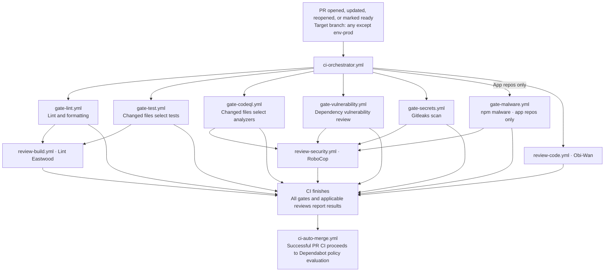
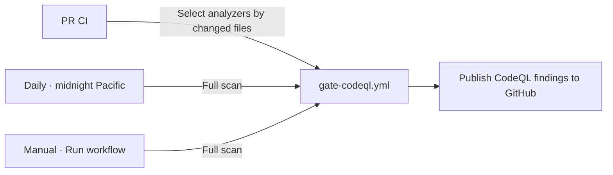
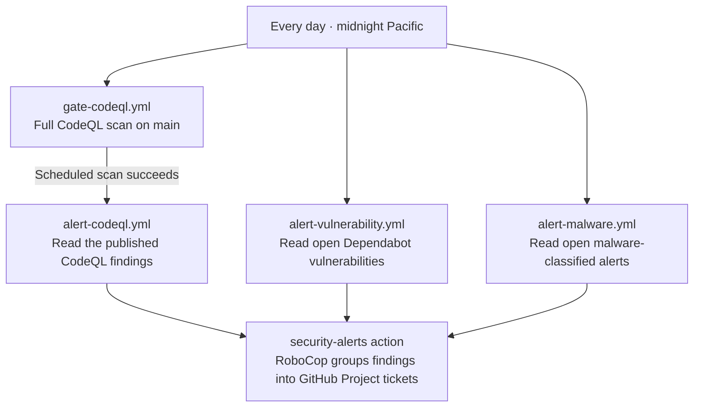
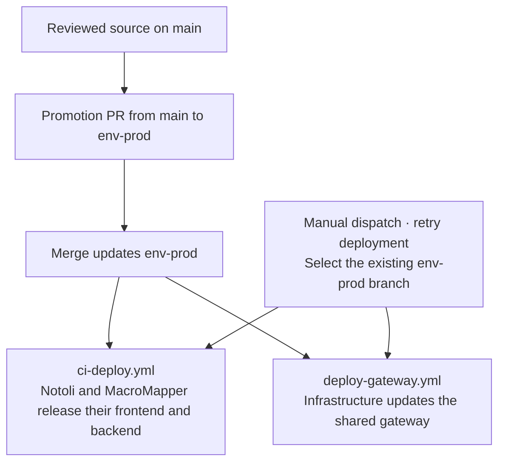

# 🔄 GitHub workflows

CI, reviews, dependency/security checks, and release behavior for MacroMapper.

## 🧭 Workflow map

| Area | Entry points |
| --- | --- |
| Pull requests | [CI orchestrator](ci-orchestrator.yml), independent gates, and the three reviewer workflows. |
| Security alerts | [CodeQL](alert-codeql.yml), [vulnerability](alert-vulnerability.yml), and [malware](alert-malware.yml) aggregation after the nightly scan or on a daily schedule, with manual dispatch for every feed. |
| Releases | [Release workflow](ci-deploy.yml). |

Workflow YAML is authoritative for triggers, permissions and job dependencies.
Read [repository setup](../README.md) before expecting secret-dependent workflows
to succeed. Commands in this guide run from the repository root.

## 🔄 Pull requests and reviews

A new CI run for a pull request cancels the older run for that pull request.
The current run follows the job dependencies in the workflow.

### Secret scan

[Gitleaks](gate-secrets.yml) scans PR commits for exposed credentials. It runs
with a read-only token and disables PR comments and artifact uploads. RoboCop
receives the job result as scanner evidence. A failed scan fails PR CI and
prevents Dependabot auto-merge.

After a successful GitHub PR run confirms the `Secret scan / Gitleaks` check
name, add that check to the `main` ruleset alongside the other required gates.

### Major-upgrade review evidence

Obi-Wan uses Dependabot's per-dependency metadata for grouped upgrades.
Release lookups use each major update's own ecosystem and target version.
Repository usage searches cover every listed dependency and retain the
tracked-file exclusions and 30,000-byte limit. Numeric Actions references
such as 7 and v7 can match a full release tag such as v7.0.0. Opaque refs
leave a visible evidence gap. Required briefs need at least one valid HTTP(S)
source URL. The publisher keeps independent body findings when it suppresses
duplicate inline comments or sees an unchanged verdict.

<a id="-pull-request-ci"></a>

### Pull-request CI

`.github/workflows/ci-orchestrator.yml` coordinates:

- Frontend Prettier and ESLint checks
- Backend Ruff checks and formatting
- React/Vitest tests and the Vite production build
- Django tests
- Node tests for repository automation
- Deployment configuration, SQLite recovery, and disposable Nginx routing tests
- CodeQL for Python, JavaScript/TypeScript, and GitHub Actions
- GitHub dependency review at high/critical severity, with detailed findings retained in the check logs and annotations
- npm malware advisory review for changed lockfile packages, including initial lockfile additions against an empty dependency baseline and batched `package@version` advisory queries
- AI code, build, and security reviews for trusted same-repository pull requests
- Dependabot auto-merge after independent gates and all three reviewers pass

For a Dependabot semver-major update, Obi-Wan also publishes a structured
**Major upgrade brief**. It uses Dependabot's exact package/version metadata,
the target release and first release of the new major line retrieved from
GitHub Releases where available, package-registry metadata for npm and PyPI
packages to locate those release notes, the supplied Dependabot pull-request
description, primary-source web search, the repository diff, and a bounded
exact-match search of tracked repository text with lockfiles excluded. Web
search is enabled only for semver-major code reviews. The brief must explain
the dependency, a cohesive upstream story covering why the update appeared,
why it required a major release, and what the repository gains, followed by a
repository-impact paragraph, a recommendation, and primary sources.
Incomplete briefs fail visibly instead of being published. The verdict and
recommendation retain Obi-Wan's calm mentor character without weakening the
technical explanation.
The brief is advisory: it does not add a required status check or replace the
existing lint, test, CodeQL, vulnerability, malware, or reviewer gates.

Path detection prevents unrelated application suites from running. A detector failure is treated as a CI failure instead of silently skipping checks.

RoboCop consumes the CodeQL scope detector's explicit language outputs and
normalizes them against successful analyzer checks and CodeQL analyses on the
default branch. A neutral GitHub summary saying that a default-branch language
configuration was omitted from a pull-request analysis is informational when
that language was intentionally out of scope and its default-branch baseline
exists. It does not block RoboCop approval when the scope and aggregate CodeQL
gates succeeded. Scope-detection failures, aggregate failures, required
analyzer failures, baseline-query failures, and genuinely absent baselines
remain visible evidence gaps.

The policy is implemented by `.github/actions/collect-codeql-evidence` and the
corresponding `gate-codeql.yml`, `ci-orchestrator.yml`, `review-security.yml`,
and `gate-test.yml` workflows.

<a id="-main-branch-protection"></a>

### Main branch protection

The active `main` ruleset requires pull requests, resolved review threads, the
lint/test/CodeQL scope and analyzer/dependency checks, the Automation Tests
check, all three AI reviewer child checks, and `Auto Merge`. The reviewers run
for trusted same-repository pull requests, including Dependabot once its six
review secrets are configured. The ruleset blocks force pushes and branch
deletion and has no bypass actors. The standalone `CodeQL` context is
intentionally not required because the scope-aware workflow does not emit that
parent check for scope-empty pull requests. Validate exact check names after
the first CI run when creating or recovering the ruleset.

<a id="-shared-mcp-framework"></a>

### Shared MCP framework

The backend test gate runs ordinary backend tests and separately runs `apps.mcp` with MCP enabled and the application factory. Synthetic OAuth and mocked provider tests cover domain permissions without live credentials or paid requests. The shared deployment workflow stays unchanged: MacroMapper enables the connection UI through its app-owned Docker build default. See [the app MCP guide](../../backend/apps/mcp/README.md#application-tools).

## 🔒 Merge and dependency controls

<a id="-dependabot"></a>

### Dependabot

`.github/dependabot.yml` checks npm, uv, GitHub Actions, and Docker dependencies
daily. Dockerfiles are under `/backend/docker` and `/frontend/docker`; npm remains
under `/frontend`. Patch and minor Dependabot updates can
auto-merge only after the lint, test, CodeQL, vulnerability, and malware gates
succeed.

The main-branch ruleset includes the orchestrator-level `Auto Merge` context
among its required checks. CI emits that top-level context
for every pull request: it reports not-applicable for ordinary contributors and
records the independent-gate result for Dependabot. A separate Dependabot-only
default-branch follow-up enables native auto-merge after successful CI; its
separate check must not become a CI prerequisite. Dependabot pull
requests remain pending while GitHub reports an unstable merge state and are
never merged directly. Third-party Actions are pinned to
immutable commit SHAs, with release-version comments retained for maintenance.
Credential-handling GitHub Actions are pinned the same way. When a complete
pull-request diff exceeds an AI reviewer's configured budget, that reviewer's
GitHub App posts an explicit incomplete-review comment under its own identity
and then fails the check without publishing a verdict.
All three reviewers inherit the same 2 MB (2,000,000-byte) source-diff budget from
`.github/actions/get-pr-diff/action.yml`; reviewer workflows do not override it.
Only the regular generated frontend/package-lock.json payload is omitted from
AI prompts and Obi-Wan's changed-file context. The independent npm malware and
Dependency Review gates cover that file. Reviewers still receive other
lockfiles, manifests, changed-file metadata, check results, and scanner evidence.
OpenAI review requests also cap combined reasoning and visible output at 16,000
tokens so they do not reserve the model's full output allowance against project
rate limits.

The shared AI review publisher keeps each native review verdict aligned with
its required Actions check. `APPROVE` and non-blocking `COMMENT` verdicts leave
the check successful. A successfully published `REQUEST_CHANGES` verdict,
including an unchanged repeat of an earlier blocking verdict, fails the
reviewer's required check so the branch ruleset prevents merging. A later
approval on a new head commit can restore a passing reviewer check.

<a id="-protected-dependabot-auto-merge"></a>

### Protected Dependabot auto-merge

FullStackTemplate (#240) owns the canonical application policy. After successful
PR CI, `ci-auto-merge.yml` runs only reviewed main code, with no PR checkout,
artifacts, caches, PAT, reviewer keys or production secrets. The API resolves the
successful CI workflow and its exact open main PR; rerun actor identity is not
used as PR authorship. Forks and non-Dependabot PRs receive a nonblocking policy
result without any automatic merge or secret-dependent review.

Each application main ruleset must require **Dependabot Policy**, pinned to the
GitHub Actions integration (15368). The follow-up creates this check in progress
on the PR head. All other required checks and all three current-head persona
approvals must pass. The check stays pending while native auto-merge is enabled
with `expectedHeadOid`, then succeeds only after validation/activation succeeds.
Failures leave it failing or pending. A later push has no policy result and
cannot inherit the preceding head's approval. This also avoids trying to enable
native auto-merge on an already-clean PR. No direct merge fallback exists.

Automatic eligibility requires exactly one verified Dependabot-authored commit
matching the current head. Explicit update types are parsed from its signed YAML
metadata with pinned PyYAML safe loading, without overriding runner event paths
or trusting PR descriptions. Every grouped member must be patch/minor; missing
metadata fails visibly and major updates stay manual. Before allowing a manual
major update, the policy disables an existing native auto-merge request.

All open Dependabot alerts are paginated with the built-in token's explicit
`vulnerability-alerts: read` permission. Every matching updated dependency must
have a known CVSS score at most 6.9. Dismissed/fixed alerts cannot hide another
open alert, and neither later group members nor alerts beyond the first page are
ignored. The workflow publishes only the policy outcome, not alert details.

The guard reads active branch rules using API 2026-03-10 (Metadata: read), checks
required contexts and integration identities, rejects requested changes and
checks every persona's current-head approval. Scoped CodeQL skips must also
match authoritative API diff paths, including previous paths on renames. Null or
unknown mergeability and propagation of the pending policy check are polled at
most six times with two-second waits; unstable/conflicting states fail closed.
A previous run's successful policy check cannot replace the pending check created by this run.
Repeated events are idempotent and genuine API failures remain visible. GitHub
retains final enforcement of review-thread resolution and all branch rules.

Generated repositories that install their own reviewer Apps can set optional
`OBI_WAN_REVIEWER_LOGIN`, `LINT_EASTWOOD_REVIEWER_LOGIN`, and
`ROBOCOP_REVIEWER_LOGIN` repository variables to their actual bot logins, including
`[bot]`. Defaults match the existing shared persona Apps. All three must be
distinct bot identities. Existing per-persona credentials and fork exclusions
remain unchanged. Repository writers who can alter workflows remain privileged;
helper checks do not constrain arbitrary workflow writers.

For activation, merge reviewed source first, then add Dependabot Policy to the
main ruleset without removing any existing requirement or bypass restriction.
The new rule requires a fresh successful CI completion to publish policy evidence;
existing open PRs may need a CI rerun. Do not require the follow-up workflow's
nested job name, which starts only after CI. No production branch is involved.
The first eligible real default-branch Dependabot follow-up remains separate
runtime acceptance in #240; a human implementation PR does not establish it.

CI supplies read-only live branch-rule/schema evidence to Obi-Wan when reviewing
auto-merge/orchestration changes. This confirms actual token access and current
GraphQL input fields without changing reviewer verdict requirements.

## 🛡️ Security and alerts

<a id="-security-alert-aggregation"></a>

### Security-alert aggregation

The daily/manual `alert-codeql.yml`, `alert-vulnerability.yml`, and `alert-malware.yml` workflows group open alerts, including every Dependabot vulnerability severity, into managed MacroMapper issues and synchronize them with the MacroMapper Project.

Additional configuration:

- Repository variable `SECURITY_ALERTS_PROJECT_ID` set to the MacroMapper
  Project v2 node ID
- Repository secret `SECURITY_ALERTS_TOKEN` with personal Project v2 access
- RoboCop installed with `Issues: write`, `Code scanning alerts: read`, and `Dependabot alerts: read`

RoboCop's short-lived App token reads alerts and performs issue mutations. `SECURITY_ALERTS_TOKEN` is used only for personal Project v2 reads/writes. The action intentionally rejects missing or reused credentials.

The Project must contain:

- `Status`: `Backlog`, `Ready`, `In Progress`, `In Review`, `Done`
- `Domain`: including `CI/CD`
- `Work type`: including `Security`
- `Priority`: `P0` through `P3`
- `Size`: `XS` through `XL`
- Numeric `Estimate`
- `Start date` and `End date`

Create or recover the board with the manual GitHub CLI and UI steps in
[repository setup](../README.md#-before-your-first-pull-request). Link it to MacroMapper,
verify its fields and views, and set `SECURITY_ALERTS_PROJECT_ID`. GitHub
excludes auto-add workflows from Project copies, so configure the required
auto-add workflows for the target repository in the GitHub UI.

<a id="-dependency-evidence-and-alert-lifecycle-parity"></a>

### Dependency evidence and alert lifecycle parity

The reusable baseline is FullStackTemplate's `.github/actions/prepare-vulnerability-report`.
MacroMapper, Notoli and Infrastructure carry the same report implementation and
regression contract. Dependency Review still blocks high/critical additions;
every non-success scanner outcome, missing/malformed output or failed evidence
preparation fails the independent Vulnerability check. No empty-array fallback
may turn unavailable evidence into a clean scan. RoboCop receives at most 16 KiB
of package/severity/manifest context, with omitted-entry counts. The
`dependency-review-evidence` artifact retains every structured entry for seven
days, excluding untrusted free text and arbitrary URLs; unavailable evidence is
retained as structured diagnostics. Artifacts have the repository's Actions
access controls, not an additional private storage boundary.

Alert synchronization saves source history/replacement links first, ensures
Project membership, then writes End date before Status Done. Done can trigger
Project auto-close. The issue client re-reads state before a separate state-only
close. Only GitHub's observed HTTP 422 `Validation Failed` with an empty errors
array is eligible for recovery, and only if another read proves closed/completed
with the exact saved lifecycle body. Other failures propagate. Partial Project
failures leave the issue open for rerun; issue mutations remain attributed to
RoboCop and Project writes use the separate Project credential. New items use
the live `Work type` field. No credentials, branch protections or deployments
change.

Historical evidence: FullStackTemplate #192 closed at 2026-10-11 16:40:51 UTC,
before run 38156425534's state-close PATCH returned 422 at 16:40:52 UTC with
`errors: []`. Notoli #825 has the same earlier pattern. All four Projects have
Auto-close issue enabled (read-only verification 2026-10-20). This establishes
the competing-close ordering; GitHub's internal validation cause is not exposed.
Mocks reproduce that interleaving and reject unrelated errors. Empty scheduled
feeds do not establish that a live close race occurred.

<a id="-compatible-codeql-updates"></a>

### Compatible CodeQL updates

Dependabot groups all `github/codeql-action` entry points (including `init`,
`analyze`, `autobuild` and `upload-sarif`) in `codeql` version-update PRs.
A separate `codeql-security` group applies the same matching to security updates;
GitHub does not combine version and security updates in one group. Keep both
patterns (`github/codeql-action` and `github/codeql-action/*`) so repository and
entry-point dependency names match. Review every CodeQL entry point together,
keep their immutable revisions aligned, and preserve normal CI/reviewer gates.

The applications retain daily updates. Infrastructure retains weekly updates,
its owner/labels/PR limits, general Actions group for non-CodeQL updates, and
separate Compose updates. The template aligns its mutable CodeQL tag with the other repositories'
immutable v4.39.1 revision. Scanner scope, permissions and merge/deployment
gates remain unchanged. Canonical rollout:
[FullStackTemplate #271](https://github.com/VanillaIceCube/FullStackTemplate/issues/271).

<a id="-atomic-codeql-regression-guard"></a>

### Atomic CodeQL regression guard

Before required scope detection, all CodeQL action entry points in workflow and
composite-action YAML must share one full immutable SHA. Structural safe parsing
covers flow mappings, quoted/escaped keys, folded values, aliases and mixed-case
owner/repository names. Negative regressions reject drift, mutable pins and
missing analysis. The existing version/security update groups and daily cadence
remain unchanged. Infrastructure adopts this guard and reviewer eligibility,
retaining weekly updates, independent Required CI and owner decisions on ordinary PRs.

```sh
uv sync --locked --project backend --only-group dev
uv run --locked --only-group dev --project backend node --test .github/actions/check-codeql-pins/*.test.js .github/actions/dependabot-auto-merge/*.test.js
```

The local actionlint 1.7.12 schema predates GitHub's documented
`vulnerability-alerts: read` scope. Its other diagnostics remain enforced; GitHub
validates the new permission and CI must pass before merge.

The reviewer API evidence step uses direct read-only API calls and executes no
PR-workspace module with its GitHub client.

Every skipped lint, test or analyzer check is now verified against the actual
reviewed detector filters, with original and renamed API diff paths. Unknown
filter forms refuse skip authorization. GitHub Action subpaths also match their
repository-level package alerts when enforcing the CVSS ceiling.

### Security-alert recovery

Each feed serializes scheduled and manual reconciliation. Before issue writes,
source coverage must be complete and unique. A valid model draft that omits refs
gets deterministic source-linked work items and an explicit warning; malformed
JSON, invalid schemas, unknown refs and duplicate memberships fail before writes.
Existing managed source refs select the canonical issue even when wording changes.

Project attachment retries transient failures at most three times, reading back
possibly committed writes before retrying. Unresolved attachments identify the
saved issue; rerun the same feed to reuse it. Reconciliation fills missing fields.
A group containing a critical alert receives P0. High or unknown severity raises
an existing P2/P3 group to P1. Other vulnerability groups default to P2. CodeQL and
malware groups default to P1. An urgent alert can raise an existing group's priority.
Higher priorities and other populated planning fields are preserved. All active groups synchronize before
superseded issues can close. Closure saves source history and End date before Done.
Only the observed empty-error or exact Issue/custom concurrent-close HTTP 422 may
recover, and only after readback proves closed/completed with the exact saved body.
All other errors remain failures. A successful empty feed does not exercise the race.

Dependabot check readiness is re-read at most six times with two-second delays.
A success conclusion and completion timestamp do not override an in-progress
status. Persistent inconsistency fails visibly; rerun CI for the current head.
Only signed exact-head patch/minor metadata can enable native auto-merge. Signed
SHA-only Action updates without update-type, restricted to Action YAML diffs,
pass policy for manual review after all checks and current-head approvals pass;
they never infer semver or activate auto-merge. Missing ordinary/group metadata fails.

Malware classification fetches each unique GHSA referenced by this repository's
open Dependabot alerts, rather than enumerating the global malware catalogue.
Empty feeds make no advisory requests. Failed or unverifiable classification
stops before source checkpoint or issue writes; it never implies no malware.

### Security policy and review scope

External Actions use verified immutable commits with readable version comments.
The shared `check-workflow-security` tests reject mutable references, broad grants
and privileged PR-target triggers. Automation tests run for all `.github/**`
changes. Forks retain credential isolation and all configured reviewers remain
required. Repository settings are audited independently of source; stage read-only
defaults/disabled workflow-token approvals and SHA enforcement after source CI
passes. Reviewer App tokens and scoped auto-merge/deployment grants remain explicit.

The PR npm malware gate scans only added/changed exact package versions, at most
25 per request, 200 requests total and 20 pages per batch, with 30-second timeouts.
A missing base lock scans the complete head; a missing head lock while a frontend
manifest remains fails. Invalid refs, unsupported/malformed locks, unverifiable
versions, API/range evidence failures and known malware fail visibly. Removing the
whole frontend has no remaining npm graph. This gate is distinct from the scheduled
repository-alert feed. Mocked regressions make no API writes or model calls.

Python malware coverage follows [the canonical decision](README.md#python-malware-coverage-limitation).
Shared deployment files are synchronized to the Infrastructure source pin, including
the approved Action-upgrade/unauthorized-drift regression. Update the source before
consumers; never edit a vendored workflow or test independently.

Repository Actions secrets are not branch-scoped: writers able to install arbitrary
workflows remain privileged. This helper validates checked-in policy but cannot
constrain a workflow that bypasses it. GitHub rulesets and independent review
remain necessary. The checker parses YAML nodes, including quoted/flow/sequence
forms, rejects aliases, duplicate and merge keys, and requires pinned PyYAML 6.0.3.

Declare permissions explicitly in the workflow or job. The checker rejects broad
grants such as `write-all` and unknown permission scopes or levels. PR CI compares
each workflow and job's effective write scopes to the same path and job on its
exact base commit. New workflows and jobs start with no approved write scopes.
The required default-branch policy repeats this comparison for main PRs using
reviewed code and Git blobs. It never executes proposed workflows. A deliberate
increase requires an independently reviewed change to the trusted policy.

### Security-alert configuration contract

The three `alert-codeql.yml`, `alert-vulnerability.yml`, and `alert-malware.yml`
workflows resolve `AI_REVIEW_MODEL`, `AI_REVIEW_REASONING_EFFORT`, and
`AI_REVIEW_MAX_OUTPUT_TOKENS` in their supported workflow `vars` context. They
pass explicit `model`, `reasoning-effort`, and `max-output-tokens` inputs to the
security-alert composite. Do not reference repository `vars` inside composite
manifests: GitHub rejects that metadata before alert fetching starts (#300).

Absent or empty values deliberately preserve `gpt-6-luna`, `medium`, and `16000`.
Nonempty overrides pass through the existing Responses policy. Configuration is
validated before source reads or issue/Project writes, including empty feeds;
invalid models, efforts or token limits fail visibly without a provider call.
All three feeds check the Project token and field schema before reading alerts.
RoboCop receives issue write access and read access to the selected feed.
Only the Project client receives the personal Project token.

`node --test .github/actions/custom-regressions/security-alert-contract.test.js`
checks actual YAML inputs/callers, audits local composites for unsupported `vars`,
and executes manifest-derived configuration, fetching, nested Responses shell,
validation and reconciliation code using synthetic feeds and mocked provider/API
writes. Existing lifecycle tests still cover complete accounting, partial-progress
recovery and the exact concurrent-close HTTP 422 case. These fixtures are not a
GitHub runner. After a reviewed repair, run one fresh controlled dispatch of each
alert workflow from corrected `main`, after checking managed labels/Project side
effects. Record runner loading/empty-feed evidence separately from nonempty mock
coverage; never rerun an old failed revision as proof of the new source.

#### CodeQL maintenance

CodeQL init/analyze entry points use the same immutable v4.39.3 revision.

Upstream [v4.39.3 release notes](https://github.com/github/codeql-action/releases/tag/v4.39.3)
cover the corrected diff-informed alert filtering used by these scanners.

#### Shared Docker login maintenance

Deployment uses docker/login-action v4.8.0 at its immutable revision from the
Infrastructure release standard. Update the canonical workflow and manifest
first, then synchronize `shared_source` in `deploy/production/app.json` and its verified files.
Rendered-only workflow upgrades fail parity.

## 🚀 Releases and promotion

Application releases use `ci-deploy.yml` for the existing `env-prod` push/manual
paths and the Infrastructure-pinned app-only release standard. Ordinary changes
land through reviewed `main` before promotion. Preserve independent app releases,
immutable image identities, private release bundles, database recovery, exact
proxy trust and all existing owner/source/branch controls. Common release changes
originate in Infrastructure and synchronize through reviewed source pins.
See the [production guide](../../deploy/production/README.md) for current setup,
readiness, migration and explicit recovery procedures. Local Compose examples
are not production release inputs.

<a id="-shared-deployment-action-update"></a>

### Shared deployment action update

Docker login v4.8.0 is rendered from the immutable Infrastructure revision
recorded under `shared_source` in `deploy/production/app.json`. Keep the pin
and generated workflow synchronized; deployment parity remains mandatory.

### Architecture and production summaries

The [canonical architecture reference](README.md#-architecture-and-trust-boundaries) maps PR/fork/
Dependabot paths, required checks, reviewer interactions, scheduled alerts,
main-to-env-prod/manual release paths and credential trust boundaries to source.

## 🧪 Checks and diagnostics

<a id="-local-automation-checks"></a>

### Local automation checks

```powershell
node --test .github/actions/collect-upstream-major-upgrade-evidence/collect-upstream-major-upgrade-evidence.test.js .github/actions/collect-codeql-evidence/collect-codeql-evidence.test.js .github/actions/publish-ai-review/publish-ai-review.test.js .github/actions/security-alerts/sync-security-alerts.test.js
python -m unittest discover -s deploy/tests -v

docker run --rm -v "${PWD}:/repo" --workdir /repo rhysd/actionlint:latest -color
```

AI review context includes bounded recent owner/collaborator reviews and replies to prior findings as discussion evidence. Prior bot verdicts must be rechecked against current source/scanners; the diff legend distinguishes active added/context lines from deleted old code. This does not change reviewer verdict rules or authorize merges/deployments.

External GitHub Actions use immutable commit SHAs with version comments.
Keep that convention when updating workflows or composite actions; preserve
review/scanner failure gates and do not treat action updates as deployment approval.

When updating the pinned `actions/create-github-app-token` revision, update the
security-alert workflow assertion in
`.github/actions/security-alerts/sync-security-alerts.test.js` and rerun the
repository automation tests. The current reviewed action revision is
`64ab729a6294000f5aa4a4bc0b73d1f32bc45510` (v3.3.0).

The shared release pin includes template-policy regression coverage coordinated
with [FullStackTemplate #217](https://github.com/VanillaIceCube/FullStackTemplate/issues/217)
and [Infrastructure #26](https://github.com/VanillaIceCube/JudeAndrewAlabaInfrastructure/pull/26).
It derives common preflight fixtures from app policy while retaining this app's
existing trust, networks, environment requirements, workflow and runtime bytes.
The same immutable source commit is proposed for all three consumers. These
source-pin PRs do not authorize merging, promotion, or deployment.

### Repository validation and failure diagnostics

Editing `gate-test.yml` triggers all app test groups. Frontend tests use two
Vitest workers, then build after the tests pass. The backend always attempts
both its ordinary and MCP-enabled suites and fails if either profile fails.
The MCP-enabled run discovers the checked-in tests under `apps.mcp`.

Repository automation uses the locked dev dependencies. Workflow and Compose
validation and release-source parity run before the test suites. The gate
discovers JavaScript action regression tests in `.github/actions` and Python
PR-diff regressions where present.

The path-aware test gate includes `.github/**`, `deploy/**`, and maintained docs
in automation validation. It runs workflow and
composite syntax, parser-only script checks and synthetic Compose configuration
plus the existing Batch 1 suites and focused mocked composite regressions.
[Coverage and external boundaries](README.md#-coverage-boundaries) are explicit.

The test workflow retains early, sampled failing and late log context within
16,000 characters for reviewers. Full output is streamed with `tee`; failed
logs have roughly 1 MiB capped artifacts retained seven days. Random delimiters
protect multiline outputs and the original command status still determines the
gate. An unavailable check cannot become success through log summarization.

Test Results fails when scope detection or an applicable development-image
validation fails. Frontend and backend test failures remain independent gates.
See frontend/README.md for setup and local commands.

Validate syntax and relevant behavioral tests after automation changes. Preserve
original check failures and bounded/redacted diagnostics. Use disposable fixtures
for validation.

<a id="-related-guides"></a>

## 📚 Reference

- [Repository setup and credentials](../README.md).
- [Local actions and reviewer contract](../actions/README.md).
- [CI/CD architecture and trust boundaries](README.md#-architecture-and-trust-boundaries).

## 🗺️ Architecture and trust boundaries

Workflow YAML and protected-branch rules remain authoritative. FullStackTemplate
owns reusable application/reviewer patterns; Infrastructure owns the gateway and
versioned application release engine. Intentional app and Infrastructure policies
remain distinct.

### PR paths and required evidence



[The orchestrator](ci-orchestrator.yml) runs on pull requests targeting any branch except `env-prod`. Same-repository human and Dependabot PRs
receive the configured reviewers. Forks receive no reviewer credentials: never
execute fork code with privileged credentials or add `pull_request_target` here.
Obi-Wan starts independently; Lint Eastwood consumes lint/test outcomes; RoboCop
consumes scanner evidence, including the secret scan. Missing evidence,
credentials, invalid output and `REQUEST_CHANGES` fail. Skipped or old-head reviews
are not current-head acceptance. The Dependabot follow-up verifies the exact head using reviewed main code.
Infrastructure also requires its Required CI aggregate. Production promotion is a separate owner action.

### CodeQL scans



### Reviewer data and write boundary

The [action contract](../actions/README.md) owns byte/page/count limits, identity,
serialized writers and reconciliation proof. Discussion and tool output are
untrusted data: they cannot authorize commands, secret disclosure, merges or
suppressed findings. Unavailable/truncated context is disclosed. Only provably
replaced, own-App feedback may be reconciled; human/other-bot threads remain open.
Reconciliation never dismisses a blocking verdict or changes required checks.
Each repository/persona retains separate credentials and the accepted Luna model.
Usage/cost estimates are partial and dated; unknown charges remain unknown.
Web search stays limited to Dependabot major-upgrade code reviews.

[Repository setup](../README.md) owns exact secret/variable names and installation
permissions. Dependabot receives required reviewer OpenAI keys/App private keys,
never production/Project credentials. RoboCop owns security-alert issue writes;
the separate Project token only synchronizes Project fields. Repository Actions
secrets are not branch-scoped: arbitrary workflow writers remain privileged.
External Actions use immutable pins. Workflow reviews cover changes to write
permissions in the workflow or job that requests them.

### Scheduled source-alert maintenance



The [vulnerability](alert-vulnerability.yml) and [malware](alert-malware.yml)
alert workflows run daily at midnight Pacific (America/Los_Angeles). The
[CodeQL alert workflow](alert-codeql.yml) follows a successful scheduled CodeQL
scan on main. All three alert workflows support manual dispatch. Incomplete
source/model evidence fails before lifecycle writes; verified closure and Project
recovery preserve their independent credential boundaries.

The CodeQL Gate analyzes scoped pull requests. The full scan
is scheduled daily at midnight Pacific and can be dispatched manually.

GitHub may delay or drop scheduled runs at the top of the hour. If a scheduled
run is missing, check that workflow's run history and use **Run workflow** on
`main` to recover the missed scan or feed. The CodeQL alert workflow runs automatically only after the scheduled scan
on main succeeds. If tracking needs a separate retry, dispatch CodeQL Alert manually.
[GitHub scheduled-event behavior](https://docs.github.com/en/actions/reference/workflows-and-actions/events-that-trigger-workflows#schedule).

### Promotion, release and manual operations



Promote exact reviewed main source through existing `env-prod` controls. Keep
independent app/gateway transactions, immutable digests, private recovery sets,
locks and explicit data-generation barriers. Compare the entire promotion diff
and independently verify running identity, routes, auth and sanitized logs.
Readiness is not authenticated/mail acceptance. Never restore older SQLite data
over newer committed writes or assume migrations can be reversed. App releases
never recreate shared ingress/networks or prune the host. Docs/workflow-only changes
need no unnecessary restart. FullStackTemplate has no active production target;
its onboarding examples do not authorize new resources or an `env-prod` branch.

### Maintaining the architecture

When editing a workflow, review its triggers, job dependencies, permissions,
and trust boundaries. Update the diagrams when those relationships change.

## 🧪 Coverage boundaries

Action-local regressions cover reviewer publishing, security-alert lifecycle,
dependency evidence and workflow permission and pin policy under their existing
gates. App repositories retain backend, frontend/browser and shared
release suites; the canonical release tests remain in Infrastructure `app-release/v1`.
Root tooling, gateway/ingress, SQLite snapshot and release-profile suites were
removed at the owner's request. Their former coverage is not provided by the
remaining checks. Mocked/local evidence does not establish live reviewer loading,
authenticated production journeys, recovery acceptance, physical-device behavior,
email receipt or paid AI behavior. Use disposable fixtures and separately authorized
runtime verification for those claims.

### Python malware coverage limitation

Keep the existing vulnerability review; it does not establish malware detection.
No mandatory Python malware service is configured. Known-advisory matching,
publishing attestations and source review cannot clear new/unknown malicious
behavior, typosquatting or compromised trusted publishers. Maintainers still review
package identity, installation hooks and dependency changes. Reconsider a gate
only with a complete immutable resolved graph, bounded feed freshness/error policy,
representative false-positive evaluation and a named maintenance owner; new services,
credentials or spend require their own review. Infrastructure's validation-tool
pins are distinct from application dependency scanning.
