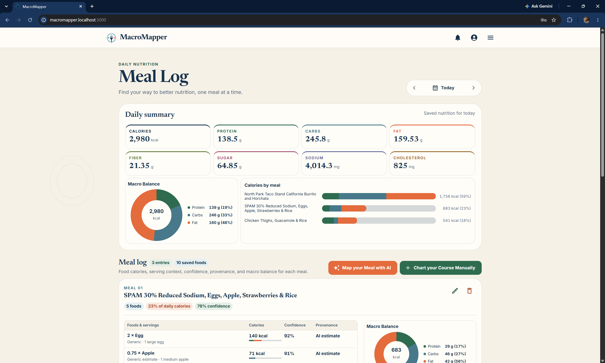
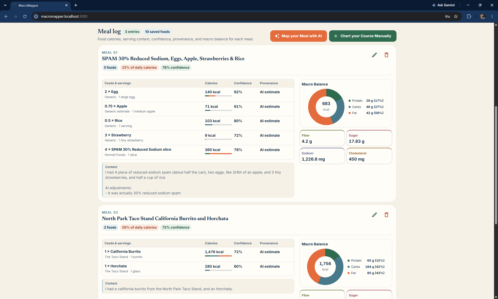
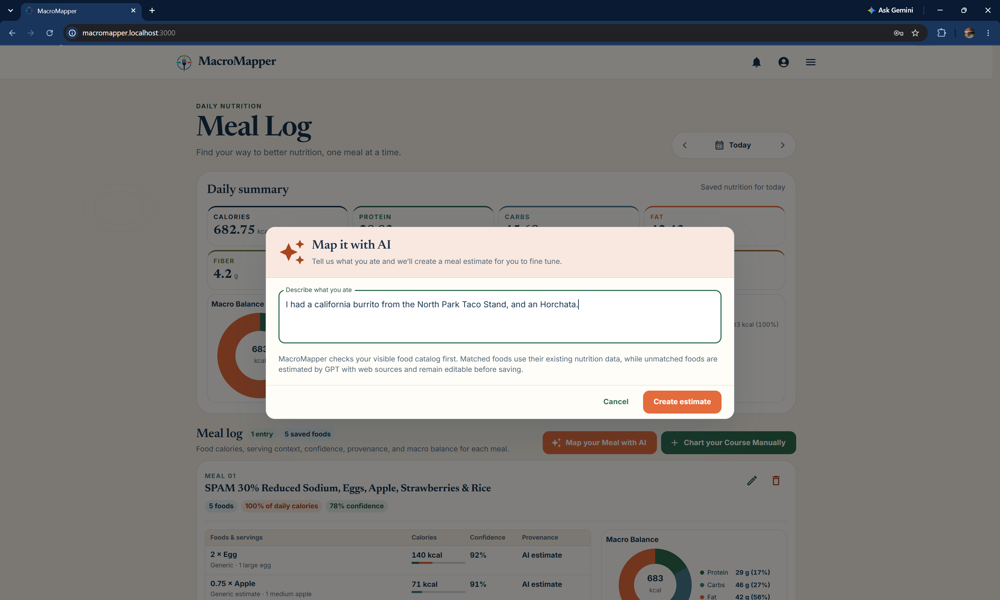
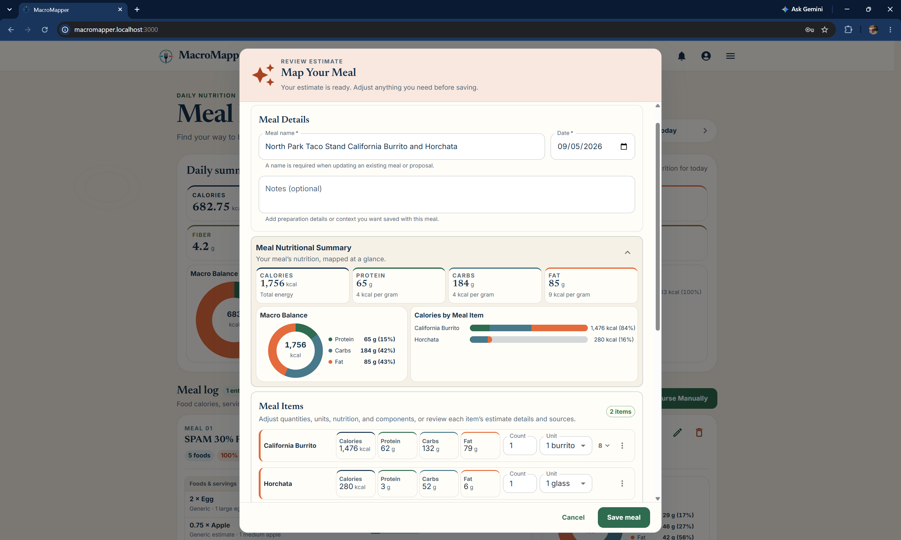
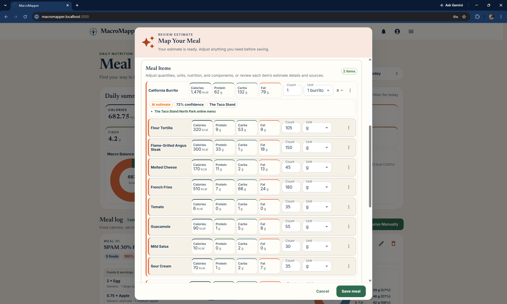
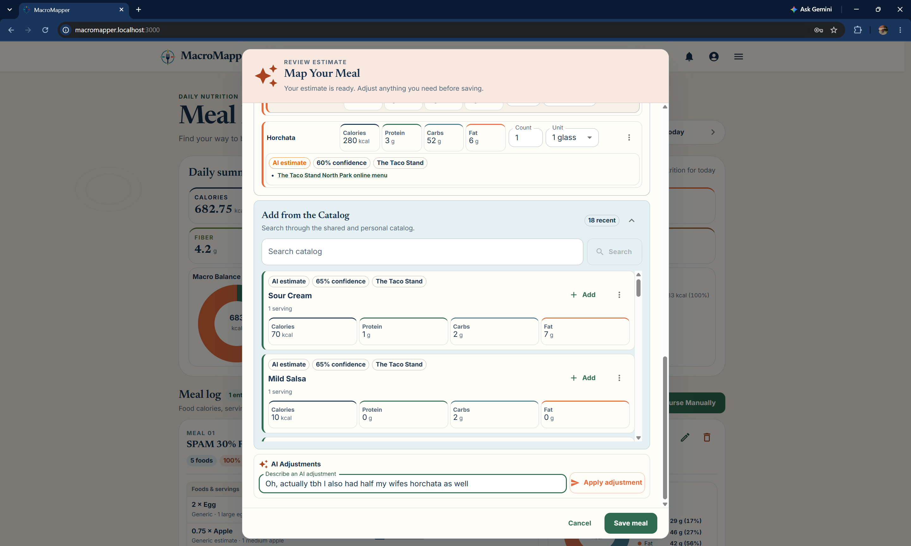

# 📸 Application tour

### Daily Nutrition Page 01

View your daily statistics.

### Daily Nutrition Page 02

View your meal-by-meal stats as well as their confidence and provenance.

### Meal Estimation Page 01

Estimate your meal with AI!

### Meal Estimation Page 02

The nutritional information for your meal!

### Meal Estimation Page 03

Break down meal items by component for easy adjustments—like, “Oh! I actually
didn't have sour cream.” The app also displays the provenance, source, and
confidence.

### Meal Estimation Page 04

Manually add items from the catalog, or use AI to make adjustments!

